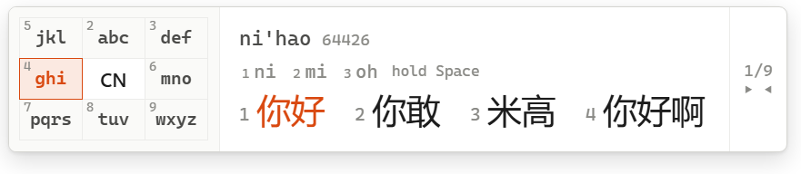
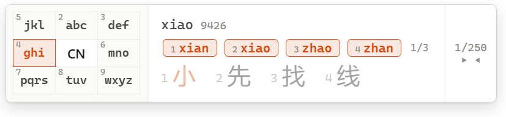
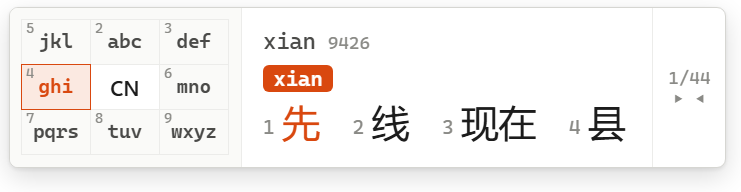
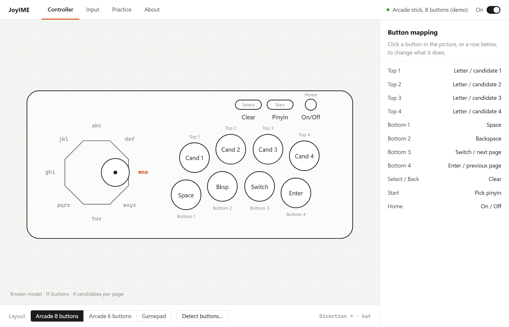
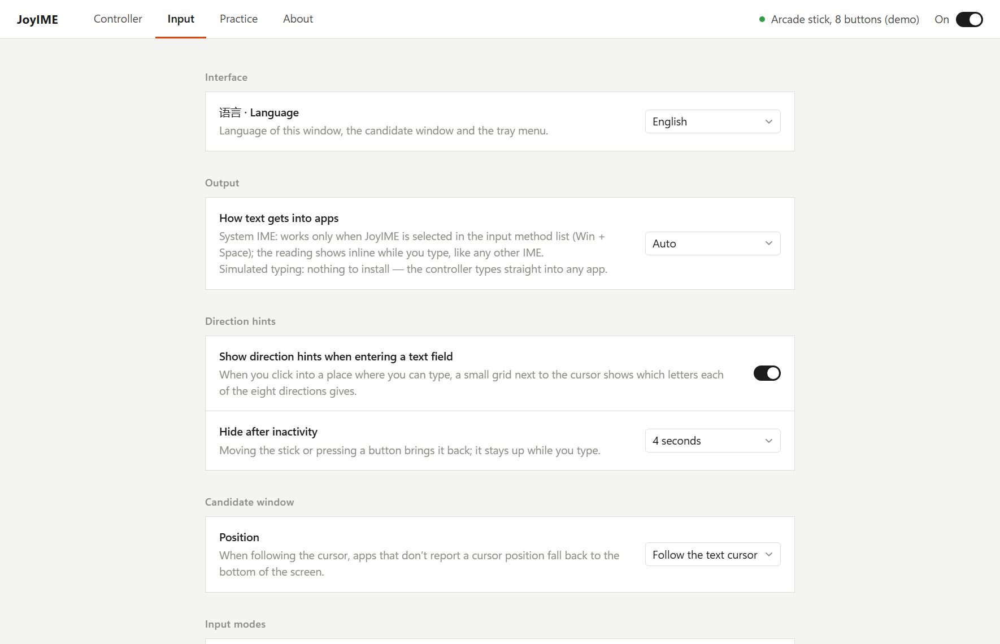
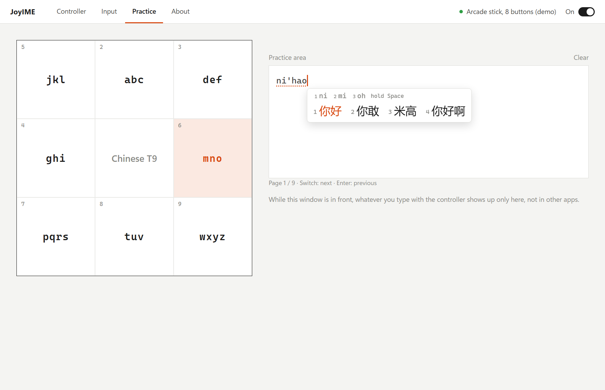

<div align="center">

# JoyIME

**Type with an arcade stick or a gamepad.**

The stick's eight directions plus centre map onto a phone's 9-key keypad: flick a direction to press a key,
use the buttons to pick candidates. Chinese T9 (with a pinyin bar), English T9 prediction, plain letters, numbers and symbols.

**English** · [简体中文](README.zh-CN.md)

[](https://github.com/Fourdotszc/JoyIME/actions/workflows/build.yml)
[](LICENSE)



</div>

---

On Windows, JoyIME is a real system input method. Pick **JoyIME 摇杆输入法** from the input method list
(<kbd>Win</kbd> + <kbd>Space</kbd>), click into any text box and start typing. The candidate window follows the text cursor,
just like a regular IME. It comes with a companion app for mapping buttons, choosing input modes and practising.

> The interface comes in English and Chinese. It follows your Windows display language; you can also pick one under **Input → Language**.

## Contents

- [Features](#features)
- [Install](#install)
- [How typing works](#how-typing-works)
- [Default button layouts](#default-button-layouts)
- [The JoyIME app (button mapping & settings)](#the-joyime-app-button-mapping--settings)
- [Supported controllers](#supported-controllers)
- [Privacy](#privacy)
- [Building from source](#building-from-source)
- [Roadmap](#roadmap) · [Credits](#credits) · [License](#license)

## Features

- **Chinese T9** – flick directions like pressing phone keys; JoyIME guesses pinyin and words (built on the open Google Pinyin dictionary, ~65,000 entries). Initials-only abbreviations work too (`zg` → 中国).
- **Pinyin bar** – when a key sequence has several readings (9426 = *xian*, *xiao*, *zhan*…), hold Space and press a top button to fix the reading, syllable by syllable, exactly like a phone's 9-key pad.
- **English T9** – word prediction and completion from a 50,000-word frequency list, automatic spaces, smart punctuation.
- **Letters, numbers and symbols** – direction + button types any letter; a phone-style number layer types digits with single flicks.
- **Remembers your words** – picked words move to the front; phrases built from several picks are learned and predicted from a prefix. Stored only on your computer.
- **Follows the cursor** – the candidate window and a 3 × 3 direction hint appear right next to the text cursor, on any monitor and DPI.
- **Any controller** – presets for 8-button arcade sticks, 6-button arcade sticks and gamepads; remap every button; a wizard for sticks whose buttons are reported in odd places.
- **System IME or simulated typing** – works through Windows' Text Services Framework (64-bit and 32-bit apps), or simply types keystrokes into any program if you don't want to install an IME.

## Install

**Windows 10 / 11 (64-bit)**

1. Download `JoyIME_x.y.z_x64-setup.exe` from [Releases](https://github.com/Fourdotszc/JoyIME/releases/latest) and run it.
   It asks for administrator rights because it registers a system input method.
   The installer isn't code-signed yet, so SmartScreen may say *"Windows protected your PC"* – click **More info → Run anyway**.
2. Plug in your stick or gamepad.
3. Press <kbd>Win</kbd> + <kbd>Space</kbd> and choose **JoyIME 摇杆输入法**.
4. Click into a text box. A small direction hint pops up next to the cursor – start flicking.

The JoyIME app starts by itself when you need it (it lives in the system tray). Open it from the Start menu or by clicking the tray icon.

**Uninstall:** Settings → Apps → JoyIME → Uninstall. Your word list stays in `%APPDATA%\com.joyime.app` unless you tick the box to remove app data.

## How typing works

### Directions are phone keys

Flick the stick in a direction and let it return to centre – that's one key press. The eight directions are the eight
letter keys of a phone keypad (key 1 has no letters, so ↖ takes key 5):

| ↖ **5** jkl | ↑ **2** abc | ↗ **3** def |
|:---:|:---:|:---:|
| ← **4** ghi | centre | → **6** mno |
| ↙ **7** pqrs | ↓ **8** tuv | ↘ **9** wxyz |

The hint window shows this grid, highlighting the direction you're pushing.

### Input modes

Press **Switch** (when you're not in the middle of a word) to switch between the modes you've enabled.
The default order is CN → EN → 123 → abc → ABC; you can turn modes on and off and reorder them in the app.

| Mode | Label | How it works |
|---|---|---|
| Chinese T9 | CN (九) | Flick keys, pick a word with the top buttons. Space picks the first candidate. |
| English T9 | EN (英) | Flick keys, JoyIME predicts the word and adds a space after it. Punctuation attaches to the word (`hello ,` → `hello, `). |
| Numbers & symbols | 123 | Flick = digit (↖ 1, ↑ 2, ↗ 3, ← 4, → 6, ↙ 7, ↓ 8, ↘ 9). At centre the top buttons type **5 0 . ,**. Direction + button types symbols such as `+ - * / ( ) @ #`. |
| Lowercase / uppercase | abc / ABC | Hold a direction and press top button 1–4 to type the 1st–4th letter of that group (↑ + button 1 = `a`). |
| Full pinyin | PY (拼) | Spell pinyin letter by letter (same as abc), get Chinese candidates. Off by default. |

When nothing is being typed in Chinese T9, the four top buttons type **，。？！** (half-width `, . ? !` if you prefer).

### Choosing the pinyin reading

On a phone, 9426 can be *xian*, *xiao*, *zhan*, *zhao*… Real 9-key keyboards show a pinyin bar so you can say which one you
mean. JoyIME does the same:

<table>
<tr>
<td width="50%"></td>
<td width="50%"></td>
</tr>
<tr>
<td><b>Hold Space</b> – the pinyin bar lights up; the numbers match the top buttons.</td>
<td><b>Press top button 1</b> – <i>xian</i> is fixed, only 先 / 线 / 现在 / 县… remain.</td>
</tr>
</table>

- **Hold Space + top button** – fix that syllable. Keep holding to fix the next one (64426 → *ni* → *hao* → 你好).
- **Hold Space + Switch / Enter** – page through the pinyin options.
- **Hold Space + Backspace** – undo the last fixed syllable.
- A quick **tap** of Space still picks the first candidate, as usual.
- Prefer a toggle? Assign **选拼音 (Pick pinyin)** to a spare button (Start, on the default layouts): press it once and the top buttons pick pinyin until you press it again.

### Paging and editing

- **Switch** = next page, **Enter** = previous page while typing; hold to flip quickly. Pages wrap around.
- **Backspace** deletes the last key; hold to repeat. With nothing being typed it's a normal Backspace.
- **Clear** (Select) throws away what you're typing.
- **On/Off** (Home) pauses JoyIME – handy when you switch back to playing a game.

## Default button layouts

Top row = the four buttons above, bottom row = the four below (as on a Vewlix-style 8-button panel).

**8-button arcade stick**

| | 1 | 2 | 3 | 4 |
|---|---|---|---|---|
| Top row | Candidate 1 | Candidate 2 | Candidate 3 | Candidate 4 |
| Bottom row | Space | Backspace | Switch / next page | Enter / previous page |

Select = Clear · Start = Pick pinyin · Home = On/Off

**6-button arcade stick**

| | 1 | 2 | 3 |
|---|---|---|---|
| Top row | Candidate 1 | Candidate 2 | Candidate 3 |
| Bottom row | Candidate 4 | Space | Backspace |

Start = Switch / next page · Select = Enter / previous page · Home = On/Off

**Gamepad (Xbox layout)**

X / Y / B / A = Candidate 1–4 · RB = Space · LB = Backspace · RT = Switch / next page · LT = Enter / previous page ·
View = Clear · Menu = Pick pinyin · Guide = On/Off · D-pad or left stick = directions

Every button can be changed in the app.

## The JoyIME app (button mapping & settings)

Open it from the Start menu or by clicking the tray icon. Closing the window only hides it; JoyIME keeps running in the tray
(right-click the tray icon to pause, resume or quit).

### Controller



- A live drawing of your stick: the directions and every button light up as you press them, so you can see what JoyIME receives.
- Each button is labelled with its function. **Click a button** (in the drawing or the list on the right) to assign another function.
- **Layout** – switch between the 8-button, 6-button and gamepad presets in one click.
- **Detect buttons…** – a short wizard asks you to press each position in turn (top 1, top 2, …). Use it if a stick reports its buttons in unusual places or isn't recognised at all; the positions are remembered per controller model.
- The status line shows whether the model was recognised, how many buttons it has and how many candidates fit on a page (one per candidate button).

### Input



| Setting | What it does |
|---|---|
| Language | **Same as Windows**, **中文** or **English**. Applies to this window, the candidate window and the tray menu. |
| Output | **Auto** (use the system IME when it's installed), **System IME** (only when JoyIME is selected with Win + Space; the reading is shown inline like any IME), or **Simulated typing** (no IME needed, types straight into any program). |
| Direction hints | Show the 3 × 3 hint when you click into a text box, and how long until it hides (2–10 s, or always). |
| Candidate window | Follow the text cursor, or stay at the bottom of the screen. |
| Input modes | Turn each mode on or off, and set the order **Switch** steps through. |
| Learning | Remember picked words and phrases; shows how many are stored, with a button to clear them. |
| Punctuation | Full-width （，。？！） or half-width (, . ? !) punctuation in Chinese modes. |

### Practice



A big direction grid and a practice box. While this window is in front, everything you type goes here only – a safe place to
learn the directions and try new button layouts.

## Supported controllers

JoyIME reads controllers through [gilrs](https://gitlab.com/gilrs-project/gilrs) with the SDL game controller database,
so most XInput and DirectInput devices should work: arcade sticks and Xbox / PlayStation / Switch Pro style gamepads.
Directions can come from the D-pad, a hat switch or the left analog stick.

If your stick isn't recognised or its buttons land in the wrong places, run **Detect buttons** once.

## Privacy

Everything runs locally. JoyIME has no network features. Your settings, button maps and learned words are plain files in
`%APPDATA%\com.joyime.app`.

## Building from source

Requirements: Rust (stable, MSVC) with the `i686-pc-windows-msvc` target for the 32-bit IME DLL, and Node.js 20+.

```bash
rustup target add i686-pc-windows-msvc
cargo test -p joyime-pinyin -p joyime-english -p joyime-core   # unit tests
cd app && npm ci && npx tauri build                            # installer → target/release/bundle/nsis/
```

Development tips (scripted end-to-end tests without a real stick, registering a dev build of the IME, logs) are in
[docs/testing.md](docs/testing.md) and [crates/joyime-tsf](crates/joyime-tsf/README.md).
Screenshots in this README are generated with `python tools/screenshots.py`.

| Path | What's inside |
|---|---|
| `crates/joyime-pinyin` | Pinyin engine: T9 digits / full pinyin / initials → candidates |
| `crates/joyime-english` | English T9 prediction |
| `crates/joyime-core` | Input state machine: stick directions and buttons → composition, candidates, output |
| `crates/joyime-tsf` | Windows system IME (TSF text service DLL) |
| `app` | The JoyIME app (Tauri): reads controllers, candidate window, settings |
| `data`, `vendor` | Dictionaries and their sources |
| `prototype` | The original browser prototype |

Every push builds the installer on GitHub Actions; pushing a `v*` tag publishes a release.

## Roadmap

- [x] Windows system IME and installer
- [x] English user interface
- [ ] macOS (InputMethodKit)
- [ ] Linux (fcitx5 / IBus)

Ideas and bug reports are welcome in [Issues](https://github.com/Fourdotszc/JoyIME/issues).

## Credits

- Chinese dictionary: Google Pinyin from the Android Open Source Project, Apache License 2.0 – see [vendor/googlepinyin/NOTICE.md](vendor/googlepinyin/NOTICE.md)
- English word list: [FrequencyWords](https://github.com/hermitdave/FrequencyWords) by Hermit Dave, MIT – see `vendor/english/`
- Built with [Tauri](https://tauri.app), [gilrs](https://gitlab.com/gilrs-project/gilrs) and [windows-rs](https://github.com/microsoft/windows-rs)

## License

[MIT](LICENSE). The dictionaries keep their own licenses listed above.
