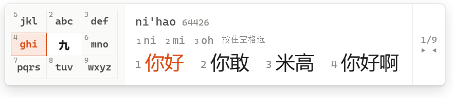
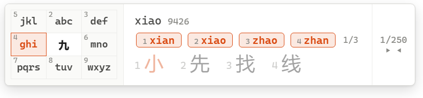
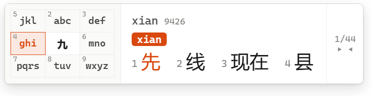
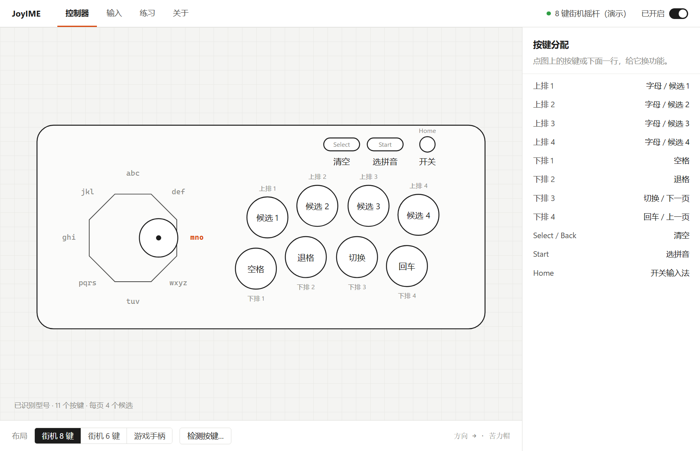
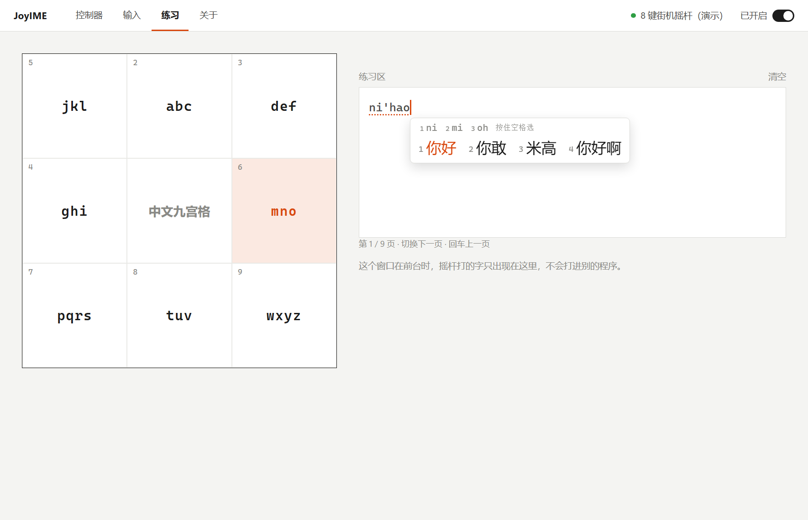

<div align="center">

# JoyIME 摇杆输入法

**用街机摇杆或游戏手柄打字。**

摇杆的八个方向加中位，正好对应手机九宫格：推一下方向就是按一下数字键，用按键选候选。
支持中文九宫格（带拼音栏）、英文九宫格联想、逐个字母、数字和符号。

[English](README.md) · **简体中文**

[](https://github.com/Fourdotszc/JoyIME/actions/workflows/build.yml)
[](LICENSE)



</div>

---

在 Windows 上，JoyIME 是一个真正的系统输入法：在输入法列表（<kbd>Win</kbd> + <kbd>空格</kbd>）里选「JoyIME 摇杆输入法」，
点进任何输入框就能打字，候选窗贴在文字光标旁边，和普通输入法一样。另外有一个配套程序，用来分配按键、选择输入方式和练习。

## 目录

- [功能](#功能)
- [安装](#安装)
- [怎么打字](#怎么打字)
- [默认按键布局](#默认按键布局)
- [JoyIME 程序（按键映射和设置）](#joyime-程序按键映射和设置)
- [支持的控制器](#支持的控制器)
- [隐私](#隐私)
- [从源码编译](#从源码编译)
- [路线](#路线) · [致谢](#致谢) · [协议](#协议)

## 功能

- **中文九宫格**：像按手机键一样推方向，自动猜拼音和词（基于开源的谷歌拼音词库，约 6.5 万条）。也能打简拼（`zg` → 中国）。
- **拼音栏**：一串键有好几种读法时（9426 = xian、xiao、zhan……），按住空格再按上排键就能定下读音，一个音节一个音节地选，和手机九键一样。
- **英文九宫格**：根据 5 万词的词频表联想、补全单词，自动加空格，标点自动贴到单词后面。
- **字母、数字和符号**：方向 + 按键能打出任何字母；数字层像手机拨号盘，推一下就是一个数字。
- **记住常用词**：选过的词下次排在前面；几次选字拼成的词组也会记住，打到一半就能联想出来。只存在你自己的电脑上。
- **跟随光标**：候选窗和九宫格方向提示就出现在文字光标旁边，多屏、不同缩放比例都正常。
- **各种控制器**：自带 8 键街机摇杆、6 键街机摇杆、游戏手柄三种预设；每个键都能改；按键位置不标准的摇杆可以用「检测按键」向导。
- **系统输入法或模拟键入**：通过 Windows 的文本服务框架（TSF）工作，64 位和 32 位程序都能用；不想装输入法的话，也可以直接往任何程序里模拟键入。

## 安装

**Windows 10 / 11（64 位）**

1. 到 [Releases](https://github.com/Fourdotszc/JoyIME/releases/latest) 下载 `JoyIME_x.y.z_x64-setup.exe` 并运行。
   需要管理员权限，因为要注册系统输入法。
   安装包暂时没有数字签名，SmartScreen 可能提示「Windows 已保护你的电脑」，点 **更多信息 → 仍要运行**。
2. 插上摇杆或手柄。
3. 按 <kbd>Win</kbd> + <kbd>空格</kbd>，选「JoyIME 摇杆输入法」。
4. 点进一个输入框，光标旁边会弹出方向提示，开始推杆。

JoyIME 程序会在需要时自动启动，常驻在系统托盘。从开始菜单打开，或者单击托盘图标都能打开设置窗口。

**卸载**：设置 → 应用 → JoyIME → 卸载。记住的字词保存在 `%APPDATA%\com.joyime.app`，卸载时勾选「删除应用数据」才会一起删掉。

## 怎么打字

### 方向就是手机键

把摇杆推向一个方向再回到中位，就是按一次键。八个方向对应手机键盘上的八个字母键
（1 键上没有字母，所以 ↖ 放的是 5 键）：

| ↖ **5** jkl | ↑ **2** abc | ↗ **3** def |
|:---:|:---:|:---:|
| ← **4** ghi | 中位 | → **6** mno |
| ↙ **7** pqrs | ↓ **8** tuv | ↘ **9** wxyz |

方向提示窗里画的就是这张表，推到哪个方向，哪个格子就会亮。

### 输入方式

没在打字时按 **切换**，就会在已打开的输入方式之间轮换。默认顺序是 九 → 英 → 123 → abc → ABC，
在程序里可以开关每种方式、调整顺序。

| 输入方式 | 标记 | 用法 |
|---|---|---|
| 中文九宫格 | 九 | 推方向打键，用上排键选词，点一下空格选第一个候选。 |
| 英文联想 | 英 | 推方向打键，自动猜单词，选词后自动补空格；标点会贴到单词后面（`hello ,` → `hello, `）。 |
| 数字符号 | 123 | 推一下就是一个数字（↖ 1、↑ 2、↗ 3、← 4、→ 6、↙ 7、↓ 8、↘ 9）；中位时上排键打 **5 0 . ,**；方向 + 按键打 `+ - * / ( ) @ #` 等符号。 |
| 小写 / 大写字母 | abc / ABC | 推住一个方向，按上排第 1–4 个键，打出这组里的第 1–4 个字母（↑ + 第 1 个键 = `a`）。 |
| 中文全拼 | 拼 | 和 abc 一样逐个打拼音字母，出中文候选。默认关闭。 |

中文九宫格里没在打字时，上排四个键直接打 **，。？！**（也可以设成半角 `, . ? !`）。

### 选拼音

手机上 9426 可能是 xian、xiao、zhan、zhao……真正的九键输入法会有一个拼音栏，让你指定是哪一个。JoyIME 也一样：

<table>
<tr>
<td width="50%"></td>
<td width="50%"></td>
</tr>
<tr>
<td><b>按住空格</b>：拼音栏亮起，编号对应上排键。</td>
<td><b>按上排第 1 个键</b>：定下 xian，候选只剩 先 / 线 / 现在 / 县……</td>
</tr>
</table>

- **按住空格 + 上排键**：定下这个音节。继续按住可以接着选下一个（64426 → ni → hao → 你好）。
- **按住空格 + 切换 / 回车**：拼音翻页。
- **按住空格 + 退格**：撤销最后定下的音节。
- **点一下**空格，还是照常选第一个候选。
- 更喜欢开关式？把「选拼音」分配给一个空闲按键（默认布局里是 Start）：按一下，上排键就改成选拼音，再按一下回到选候选。

### 翻页和修改

- 打字时 **切换** = 下一页，**回车** = 上一页，按住可以连续翻，翻到头会回到另一头。
- **退格** 删掉最后一个键，按住连删；没在打字时就是普通的退格。
- **清空**（Select）把正在打的全部丢掉。
- **开关**（Home）暂停 JoyIME，回去玩游戏时很方便。

## 默认按键布局

上排 = 上面四个键，下排 = 下面四个键（按 Vewlix 式 8 键面板）。

**8 键街机摇杆**

| | 1 | 2 | 3 | 4 |
|---|---|---|---|---|
| 上排 | 候选 1 | 候选 2 | 候选 3 | 候选 4 |
| 下排 | 空格 | 退格 | 切换 / 下一页 | 回车 / 上一页 |

Select = 清空 · Start = 选拼音 · Home = 开关

**6 键街机摇杆**

| | 1 | 2 | 3 |
|---|---|---|---|
| 上排 | 候选 1 | 候选 2 | 候选 3 |
| 下排 | 候选 4 | 空格 | 退格 |

Start = 切换 / 下一页 · Select = 回车 / 上一页 · Home = 开关

**游戏手柄（Xbox 布局）**

X / Y / B / A = 候选 1–4 · RB = 空格 · LB = 退格 · RT = 切换 / 下一页 · LT = 回车 / 上一页 ·
View = 清空 · Menu = 选拼音 · Guide = 开关 · 十字键或左摇杆 = 方向

每个键都能在程序里改。

## JoyIME 程序（按键映射和设置）

从开始菜单打开，或者单击托盘图标。关掉窗口只是把它藏起来，JoyIME 还在托盘里运行
（右键托盘图标可以暂停、恢复或退出）。

### 控制器



- 摇杆的实时示意图：推方向、按任何键都会亮起来，一眼就能看出 JoyIME 收到了什么。
- 每个键上写着它的功能。**点一个键**（图上或右边列表里）就能给它换功能。
- **布局**：一键切换 8 键、6 键、游戏手柄三种预设。
- **检测按键…**：一个小向导，让你按位置依次按一遍（上排 1、上排 2……）。摇杆报告的按键位置不标准、或者完全认不出型号时用它；记下的位置按手柄型号保存。
- 状态行显示有没有认出型号、一共几个键、每页能放几个候选（有几个候选键就放几个）。

### 输入


| 设置 | 作用 |
|---|---|
| 字怎么打进程序 | **自动**（装了系统输入法就用它）、**系统输入法**（在 Win + 空格 里选了 JoyIME 才工作，读音显示在文字里，和普通输入法一样）、**模拟键入**（不用装输入法，直接往任何程序里打字）。 |
| 方向提示 | 点进输入框时要不要显示九宫格提示，以及多久没操作后收起（2–10 秒，或者一直显示）。 |
| 候选窗位置 | 跟随文字光标，或者固定在屏幕底部。 |
| 输入方式 | 开关每种输入方式，设置按 **切换** 时的顺序。 |
| 记住常用的字词 | 记住选过的字词和词组；显示已经记住了多少条，可以一键清空。 |
| 标点 | 中文输入时用全角（，。？！）还是半角（, . ? !）。 |

### 练习



一个大的方向九宫格加一个练习框。这个窗口在前台时，打的字只出现在这里，适合熟悉方向、试新的按键布局。

## 支持的控制器

JoyIME 通过 [gilrs](https://gitlab.com/gilrs-project/gilrs) 和 SDL 手柄数据库读控制器，大多数 XInput、DirectInput 设备都应该能用：
街机摇杆，以及 Xbox / PlayStation / Switch Pro 这类手柄。方向可以来自十字键、苦力帽或左摇杆。

摇杆认不出来，或者按键位置不对，运行一次 **检测按键** 就好。

## 隐私

所有东西都在本地运行，JoyIME 不联网。设置、按键映射和记住的字词都是 `%APPDATA%\com.joyime.app` 里的普通文件。

## 从源码编译

需要 Rust（stable，MSVC），加上 `i686-pc-windows-msvc` 目标用来编 32 位输入法 DLL；以及 Node.js 20 以上。

```bash
rustup target add i686-pc-windows-msvc
cargo test -p joyime-pinyin -p joyime-english -p joyime-core   # 单元测试
cd app && npm ci && npx tauri build                            # 安装包 → target/release/bundle/nsis/
```

开发相关（不用真摇杆的脚本化端到端测试、注册开发版输入法、日志）见 [docs/testing.md](docs/testing.md)
和 [crates/joyime-tsf](crates/joyime-tsf/README.md)。README 里的截图用 `python tools/screenshots.py` 生成。

| 目录 | 内容 |
|---|---|
| `crates/joyime-pinyin` | 拼音引擎：九宫格数字 / 全拼 / 简拼 → 候选 |
| `crates/joyime-english` | 英文九宫格联想 |
| `crates/joyime-core` | 输入状态机：摇杆方向和按键 → 拼写、候选、上屏 |
| `crates/joyime-tsf` | Windows 系统输入法（TSF 文本服务 DLL） |
| `app` | JoyIME 程序（Tauri）：读控制器、候选窗、设置窗口 |
| `data`、`vendor` | 词库和它们的来源 |
| `prototype` | 最早的网页原型 |

每次推送都会在 GitHub Actions 上打安装包；推 `v` 开头的标签会自动发布 Release。

## 路线

- [x] Windows 系统输入法和安装包
- [ ] 英文界面
- [ ] macOS（InputMethodKit）
- [ ] Linux（fcitx5 / IBus）

欢迎在 [Issues](https://github.com/Fourdotszc/JoyIME/issues) 里提想法和问题。

## 致谢

- 中文词库：Android 开源项目的谷歌拼音词库，Apache License 2.0，见 [vendor/googlepinyin/NOTICE.md](vendor/googlepinyin/NOTICE.md)
- 英文词表：Hermit Dave 的 [FrequencyWords](https://github.com/hermitdave/FrequencyWords)，MIT，见 `vendor/english/`
- 基于 [Tauri](https://tauri.app)、[gilrs](https://gitlab.com/gilrs-project/gilrs) 和 [windows-rs](https://github.com/microsoft/windows-rs)

## 协议

[MIT](LICENSE)。词库各自遵循上面列出的协议。
